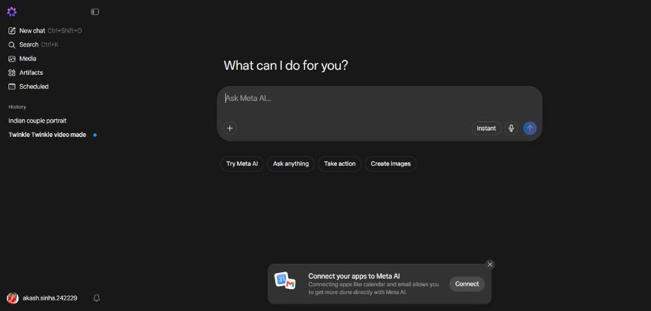
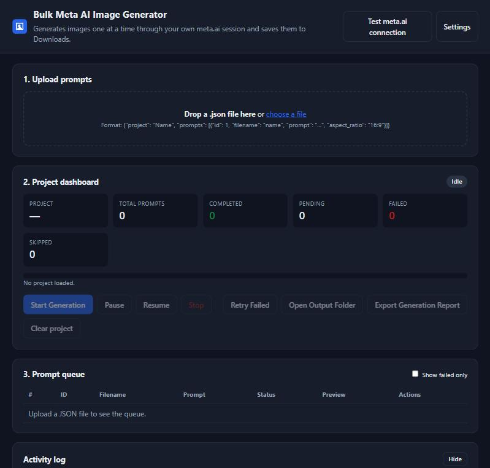
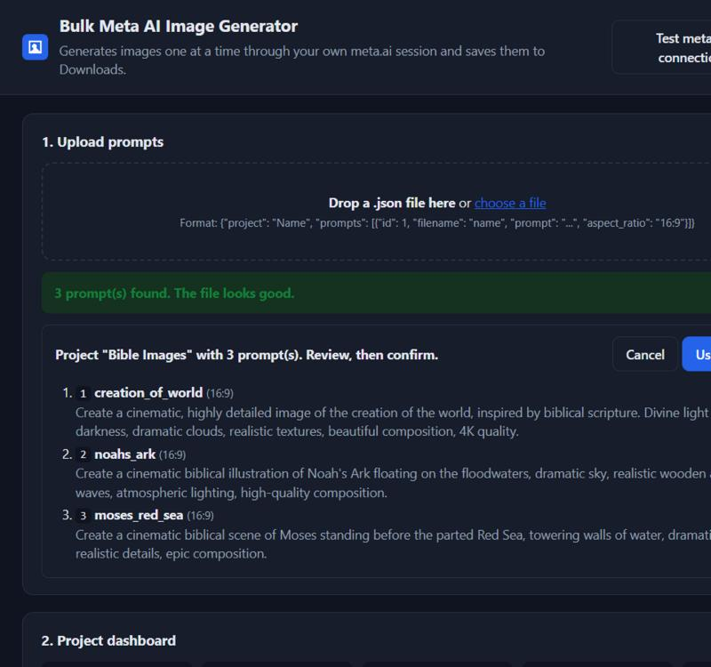
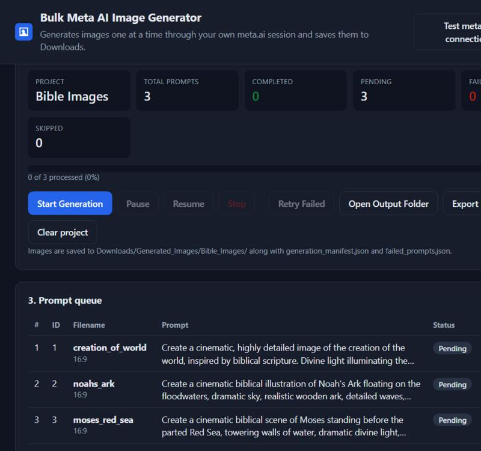
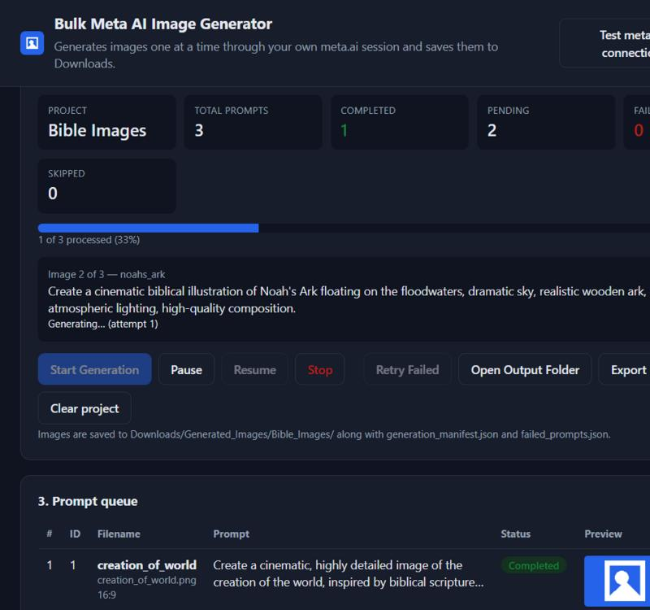
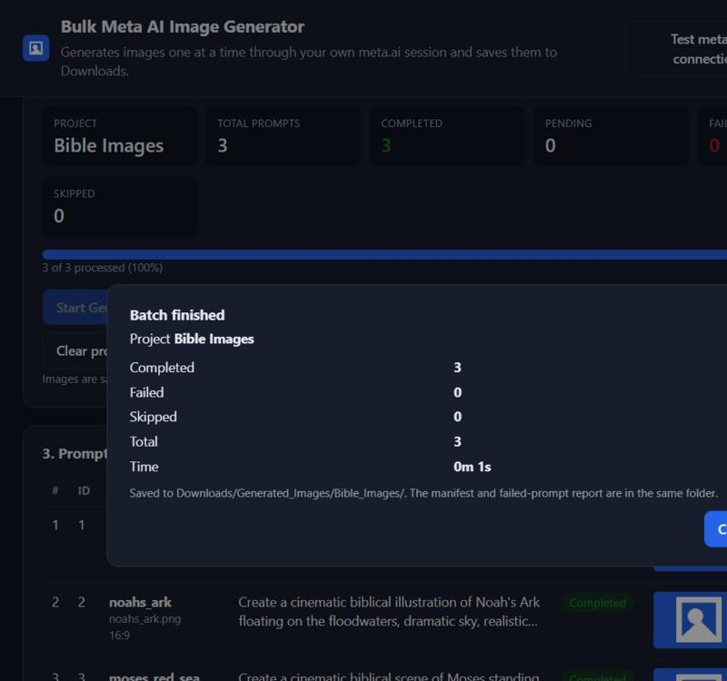
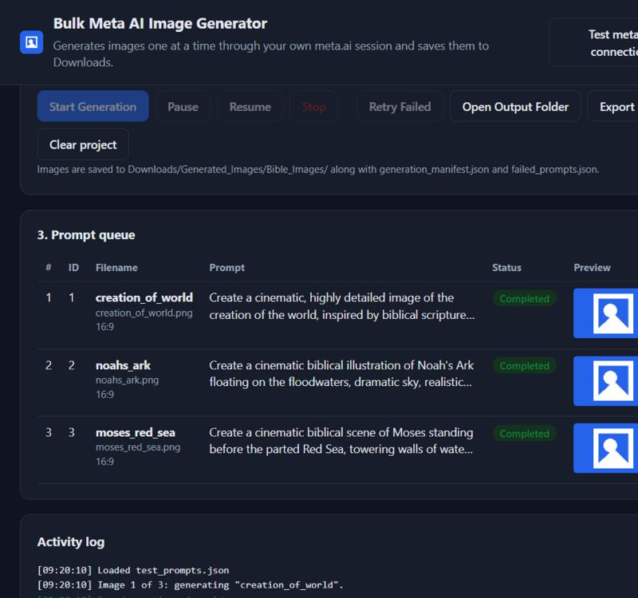
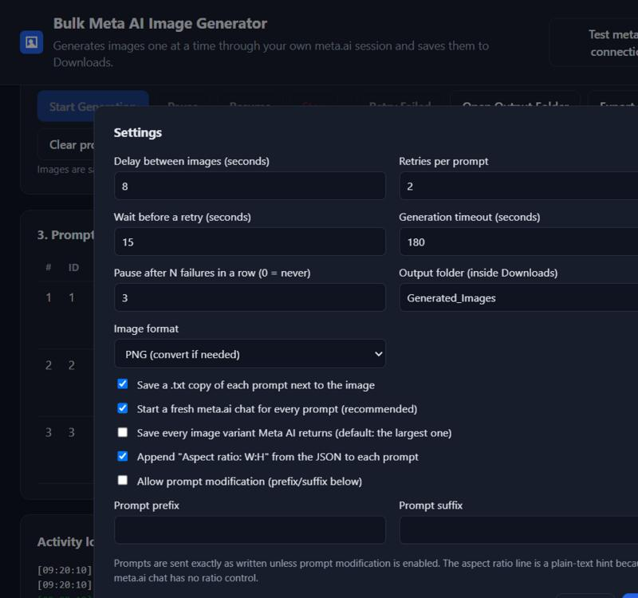

# Bulk Meta AI Image Generator: Step-by-step Guide (Hinglish)

Yeh tool ek browser extension hai jo Chrome ya Brave mein chalta hai. Aap ek JSON file upload karte ho,
Start dabate ho, aur yeh aapke apne meta.ai account se ek-ek karke images bana ke Downloads folder mein save karta hai.
Koi payment nahi, koi server nahi.

---

## Step 1: Extension install karo (sirf ek baar)

1. Brave mein address bar mein `brave://extensions` likho (Chrome mein `chrome://extensions`).
2. Upar right mein **Developer mode** ON karo.
3. **Load unpacked** dabao aur yeh folder choose karo:
   `C:\Users\Prince\Desktop\project\image generation\extension`
   (kisi aur ko diya hai toh woh `Bulk-Meta-AI-Image-Generator-v1.0.0.zip` unzip karke us folder ko choose kare).
4. Extension list mein "Bulk Meta AI Image Generator" dikhne lagega. Toolbar mein puzzle icon dabao aur ise pin kar lo.

> Agar code update hua ho toh yahin aake extension ke card pe **Reload** (gol arrow) dabana padta hai.

---

## Step 2: meta.ai pe login karo

1. Nayi tab mein <https://www.meta.ai> kholo.
2. Apne Facebook/Instagram account se login karo. Extension kabhi login nahi karta, yeh aap khud karte ho.
3. Page aisa dikhna chahiye, neeche "Ask Meta AI..." ka box ke saath:



> Brave mein agar page adhura load ho, toh address bar ke lion icon (Shields) ko meta.ai ke liye OFF kar do.

---

## Step 3: Dashboard kholo

Toolbar mein extension ka icon dabao. Yeh dashboard khulega:



Pehle **Test meta.ai connection** dabao. Popup mein yeh aana chahiye:

- Logged in: yes
- Chat box found (div)
- Send button found

Agar "Logged in: NO" aaye toh Step 2 dobara karo.

---

## Step 4: JSON file upload karo

Apni JSON file ko dashed box pe drag-drop karo, ya **choose a file** dabao.
Test ke liye `samples\test_prompts.json` use karo (3 prompts).

File ka format:

```json
{
  "project": "Bible Images",
  "prompts": [
    { "id": 1, "filename": "creation_of_world", "prompt": "Create a cinematic ...", "aspect_ratio": "16:9" },
    { "id": 2, "filename": "noahs_ark", "prompt": "Create a cinematic ...", "aspect_ratio": "16:9" }
  ]
}
```

- `filename` aur `prompt` zaroori hain. `id` aur `aspect_ratio` optional.
- File check hoti hai: kitne prompts mile, koi galti hai toh laal box mein saaf message aata hai.



Prompts sahi lagein toh **Use these prompts** dabao.

---

## Step 5: Start Generation

Ab dashboard pe project ka naam, total prompts aur pending count dikhega. **Start Generation** dabao.



Generation chalte waqt:

- "Image 2 of 3" jaisa progress, current prompt aur status dikhta hai.
- meta.ai wali tab apne aap har prompt ke liye nayi chat kholti hai, prompt type karti hai aur send karti hai.
- Har image ke beech default 8 second ka gap hai (Settings mein badal sakte ho).



Buttons:

| Button | Kya karta hai |
|---|---|
| Pause | Current image poori hone ke baad ruk jata hai |
| Resume | Agle pending prompt se dobara shuru |
| Stop | Aur koi prompt submit nahi hota; baad mein Resume se baaki chala sakte ho |
| Retry Failed | Sirf fail hue prompts dobara chalata hai |
| Open Output Folder | Images wala folder file manager mein kholta hai |
| Export Generation Report | Manifest ki timestamped copy banata hai |

---

## Step 6: Result dekho

Batch khatam hone pe summary popup aata hai:



Queue table mein har prompt ka status, saved file ka naam aur preview dikhta hai. Fail hui row pe **Retry** button hota hai.



Files yahan milti hain:

```
C:\Users\Prince\Downloads\Generated_Images\Bible_Images\
    creation_of_world.png
    noahs_ark.png
    moses_red_sea.png
    prompts\creation_of_world.txt   (original prompt ki copy)
    generation_manifest.json        (id, filename, prompt, status, path, time, error)
    failed_prompts.json             (sirf fail hue prompts)
```

Purani file kabhi overwrite nahi hoti: same naam dobara aaye toh `naam (1).png`, `naam (2).png` banta hai.

---

## Settings (optional)



- **Delay between images**: Meta ki limits se bachne ke liye 8-15 second rakho.
- **Retries per prompt**: temporary error pe kitni baar dobara try kare.
- **Output folder**: Downloads ke andar subfolder ka naam.
- **Image format**: PNG (default) ya Meta ka original format (WebP).
- **Save every image variant**: Meta AI kabhi 2 images deta hai; ON karo toh dono save hongi (`naam.png`, `naam_v2.png`).
- **Allow prompt modification**: tabhi prompt mein prefix/suffix judta hai, warna prompt bilkul waisa hi jata hai jaisa file mein hai.

---

## Agar browser band ho jaye?

Progress har image ke baad save hota hai. Browser dobara kholke dashboard kholo: bani hui images dobara nahi banti,
adhuri wali retry hoti hai, aur batch wahin se chalta hai.

## Common problems

| Problem | Kya karein |
|---|---|
| "You are not logged in to meta.ai" | meta.ai tab mein login karo, phir Resume |
| "Could not find the chat box" | meta.ai tab kholke dekho page load hua ya nahi; Brave Shields off karo; phir Resume |
| "No image appeared within 180s" | Internet slow ya Meta busy; Retry Failed dabao ya timeout badhao |
| "Paused after 3 failures in a row" | meta.ai tab check karo (limit/login), phir Resume |
| Log mein "saved in original format" | Image WebP mein save hui; kaam chalta hai, Settings mein "Original" bhi rakh sakte ho |
